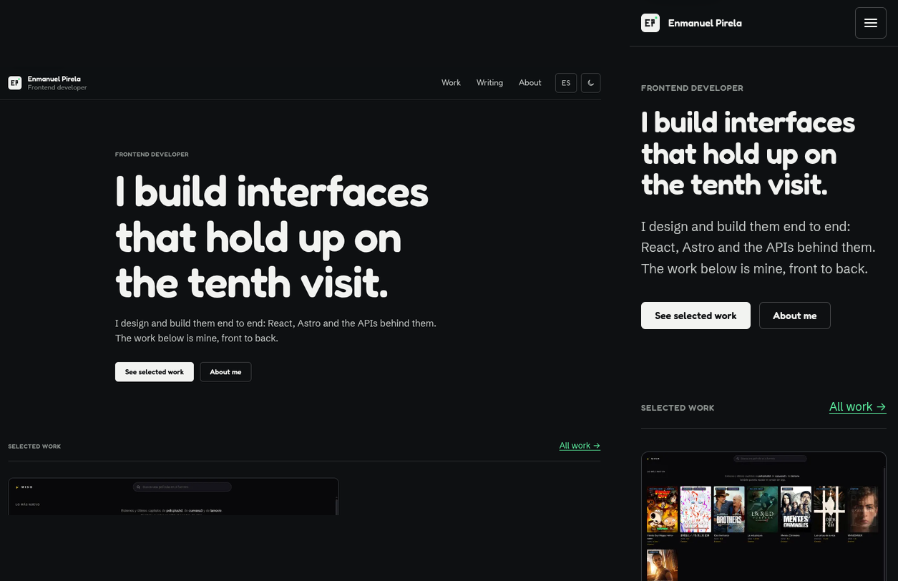

# Enmanuel Pirela — Portfolio

<div align="center">



[](https://enmanuelpirela.vercel.app)
[](https://github.com/enmanuel400)

</div>

Portfolio personal de **Enmanuel Pirela**, desarrollador frontend. Tres casos de estudio, un blog técnico y un formulario de contacto que funciona de verdad: lo que escribas llega a mi correo.

Bilingüe (inglés en `/` y español en `/es/`), tema oscuro por defecto con conmutador claro/oscuro, y pensado para móvil de verdad: menú desplegable accesible, áreas táctiles de 44 px y nada que se desborde a 320 px.

## Qué incluye

- **Casos de estudio** — [kata](https://enmanuelpirela.vercel.app/work/kata/), [miso](https://enmanuelpirela.vercel.app/work/miso/) y [sysdash](https://enmanuelpirela.vercel.app/work/sysdash/), con capturas, decisiones y resultado.
- **Escritos** — artículos sobre interfaz y desarrollo, en inglés y español.
- **Sobre mí** — trayectoria autodidacta y formulario de contacto al final.
- **Accesibilidad cuidada** — navegación por teclado, enlace «saltar al contenido», foco visible, `aria` donde toca y respeto por `prefers-reduced-motion`. Lighthouse: 100 en accesibilidad, buenas prácticas y SEO.
- **SEO y redes** — canónicas y `hreflang`, `sitemap.xml`, `robots.txt` e imagen social generada por código.

## Stack


- **Astro 7** con el adaptador `@astrojs/vercel`: todo estático salvo la ruta del formulario, que se ejecuta como función.
- **CSS nativo** con tokens propios, sin framework: `src/styles/tokens.css` y `src/styles/base.css`.
- **Tipografías** autoalojadas: Fredoka (display), Schibsted Grotesk (texto) y JetBrains Mono (código).
- **Contenido** en colecciones de Astro (`projects`, `writing`), Markdown, un archivo por idioma.
- **Formulario** con [Resend](https://resend.com), validación en servidor, trampa anti-spam y límite por IP.

## Estructura

```text
src/
  components/      cabecera, pie y bloques de cada página
  content/
    projects/      los 3 casos de estudio (.en.md / .es.md)
    writing/       los artículos, un archivo por idioma
  data/            consultas y ayudas de contenido
  i18n/            textos de interfaz y utilidades de idioma
  layouts/         Base.astro: metadatos, tema, idioma y movimiento
  pages/           rutas (/, /work, /writing, /about, /es, /api/contact, 404)
  styles/          tokens de diseño y primitivas
scripts/
  og.mjs           genera la imagen social (public/og.png)
  check-links.mjs  revisa los enlaces internos del sitio compilado
```

## Empezar

```bash
npm install
npm run dev          # http://localhost:4321
npm run build        # genera la salida para Vercel
npm run check        # tipos y comprobaciones de Astro
npm run check:links  # enlaces internos (requiere build previo)
npm run og           # regenera public/og.png
```

## Formulario de contacto

El endpoint `POST /api/contact` envía el mensaje con [Resend](https://resend.com). Necesita dos variables de entorno:

| Variable | Para qué |
| --- | --- |
| `RESEND_API_KEY` | Clave de Resend (obligatoria). |
| `CONTACT_FROM` | Remitente; por defecto `Portfolio <onboarding@resend.dev>`. |

En local van en `.env` (ignorado por git). En Vercel, en *Settings → Environment Variables*; ojo: los cambios de entorno solo se aplican a **despliegues nuevos**.

## Despliegue

En Vercel, con la app en la raíz del repositorio:

- **Root Directory:** `.` · **Framework:** Astro (detección automática) · **Node:** 22.x
- Variables de entorno: `RESEND_API_KEY` y, si quieres, `CONTACT_FROM`.

El portfolio anterior (*trazo v.03*, inmersivo) sigue en `recorrido/` como referencia y no forma parte de este build.
