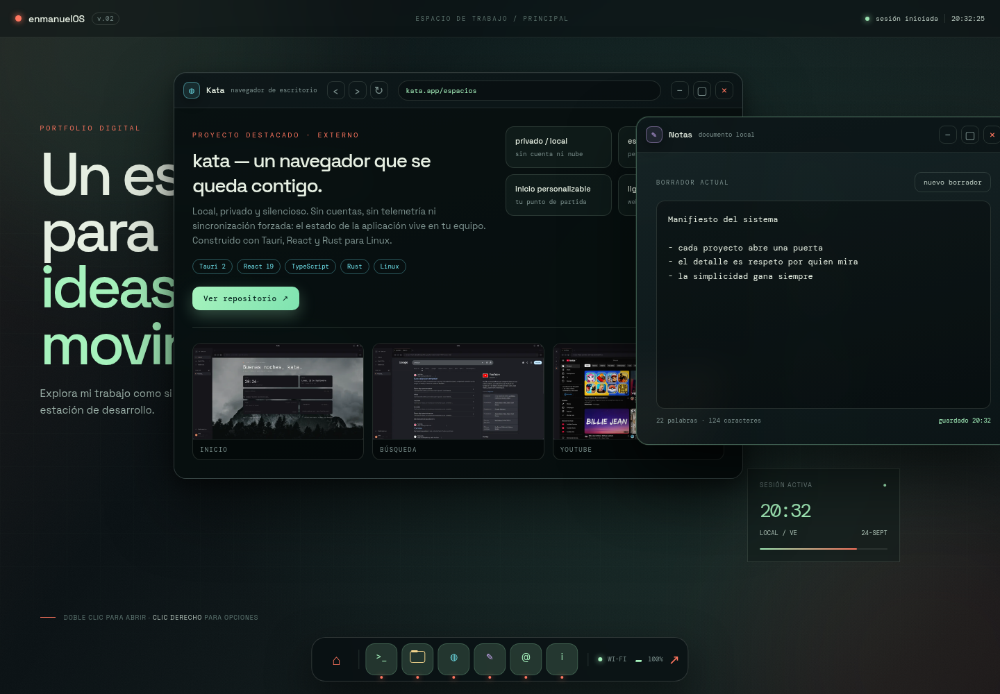
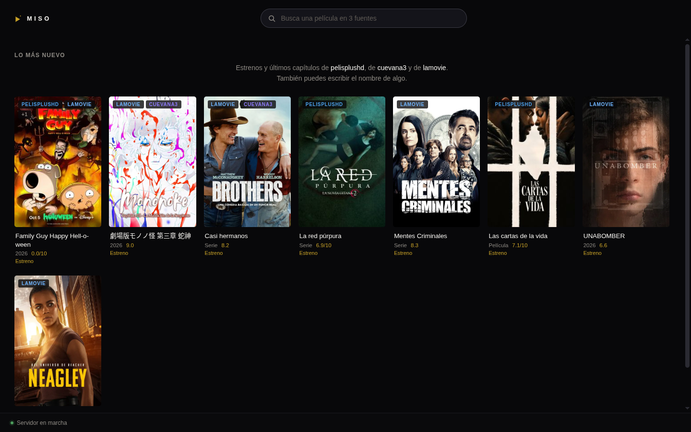
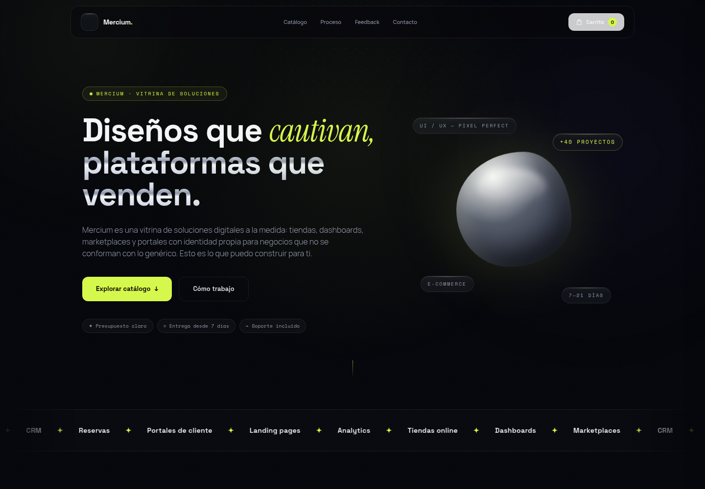
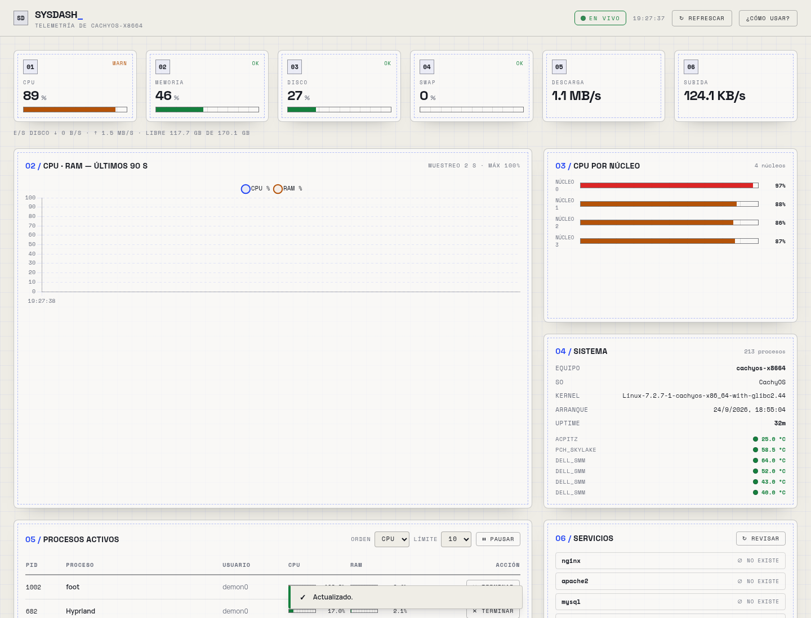
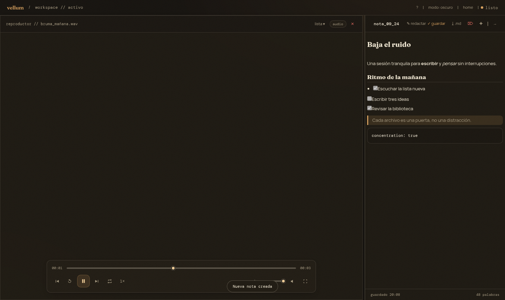

# Portfolio de proyectos

Un conjunto de experiencias digitales creadas con enfoque en producto, diseño, experiencia de usuario y desarrollo frontend.

> **Nuevo:** `recorrido/` — el portfolio inmersivo *trazo v.03*, una línea continua que recorre quién soy y mis seis proyectos, abriendo con kata y miso. El portfolio tipo escritorio (v.02) vive dentro como estación 05.

## Stack principal

## Overview

Este repositorio reúne una selección de proyectos orientados a resolver problemas reales con interfaces claras, visuales modernas y soluciones funcionales. La intención es mostrar una visión integral del trabajo: desde presentaciones visuales y landing pages hasta dashboards técnicos y espacios de trabajo personal.

Cada proyecto refleja una forma distinta de pensar en producto, diseño y experiencia digital: comunicar valor, monitorear rendimiento, organizar ideas o presentar una identidad más memorable.

## Estado del portfolio

- Recorrido: nuevo sitio inmersivo (trazo v.03) — listo para desplegar
- Miso: buscador federado de streaming (Electron + React + TypeScript) — repositorio externo
- Kata: navegador privado de escritorio (Tauri 2 + React + Rust) — repositorio externo
- Desktop: disponible en vivo en Netlify
- Mercium Shop: disponible en vivo en Netlify
- Sysdash: disponible como proyecto local con backend Python y frontend visual
- Vellum: proyecto desktop local orientado a productividad visual

## Qué construyo

- interfaces premium y funcionales
- experiencias web con foco en claridad y conversión
- prototipos de productos digitales con identidad visual propia
- dashboards y herramientas útiles para análisis y monitoreo
- soluciones con una fuerte sensibilidad por UX y diseño de producto

## Proyectos destacados

### Recorrido — trazo v.03

Portfolio inmersivo presentado como **una línea continua** que conecta estaciones: quién soy, el mapa del recorrido y los seis proyectos —**kata y miso al frente** (los más complejos), seguidos de trazo, Mercium, Sysdash y Vellum— con transiciones de scroll cinematográficas, gráficas en canvas en vivo, el navegador Kata con sus capturas reales y el buscador federado de Miso con búsqueda simulada funcional.

- Propósito: presentar el trabajo como un viaje, del quién soy al cierre
- Tecnologías: HTML, CSS, JavaScript + GSAP ScrollTrigger
- Demo en vivo: https://trazo-v03.vercel.app
- Carpeta: `recorrido/` — se abre con `python3 -m http.server 8123 --directory recorrido`

### Kata

Navegador de escritorio **privado, local y silencioso**: sin cuentas, sin telemetría ni sincronización forzada — el estado vive en el equipo del usuario. Construido para Linux con Tauri.

- Propósito: un navegador que se queda contigo, sin dejar rastro a terceros
- Público: usuarios que valoran la privacidad y un navegador liviano
- Tecnologías: Tauri 2, React 19, TypeScript, Rust
- Destacado: el otro de los dos proyectos más complejos del recorrido (junto a miso); repositorio en [github.com/enmanuel400/Kata](https://github.com/enmanuel400/Kata)

### Miso

Buscador federado de streaming **de escritorio**: consulta varias webs a la vez, unifica los resultados en una cuadrícula (el mismo título en varias fuentes se agrupa en una sola tarjeta con la insignia `+N`) y reproduce el vídeo **dentro de la app** —sin pestañas, sin ventanas emergentes y sin publicidad—. Todo ocurre en tu equipo: no es un sitio web, levanta su propio servidor Node local y lo apaga cuando se cierra.

- Propósito: buscar una vez y encontrar en todas partes, con una experiencia limpia y privada
- Público: cualquiera que consuma cine y series repartidos entre varios servicios
- Tecnologías: Electron, Node/Express, React + Vite, TypeScript, Playwright, hls.js
- Cómo funciona: proxies locales de imagen y HLS que resuelven el CORS de los CDN, y extracción en cascada — HTML → embeds → Chromium headless — que se detiene en cuanto algo es reproducible y válido
- Destacado: es uno de los dos proyectos más complejos del recorrido (junto a kata); repositorio en [github.com/enmanuel400/Miso](https://github.com/enmanuel400/Miso)

### Desktop

Portfolio presentado como una **experiencia de escritorio real** (trazo v.02): arranque del sistema, gestor de ventanas con minimizar/maximizar, dock con magnificación, iconos arrastrables, menú contextual, tres fondos de pantalla y terminal interactiva.

- Propósito: crear una experiencia memorable y diferenciada para mostrar trabajos, redes y contacto
- Público: recruiters, clientes y colaboradores
- Tecnologías: HTML, CSS, JavaScript
- Destacado: incluye un showcase del navegador **kata** (Tauri 2 + React + Rust) con capturas reales y enlace a [github.com/enmanuel400/Kata](https://github.com/enmanuel400/Kata)

### Mercium Shop

Landing page comercial orientada a ventas y servicios digitales.

- Propósito: comunicar valor, presentar soluciones y captar leads
- Público: startups, negocios y marcas
- Tecnologías: HTML, Tailwind CSS, JavaScript

### Sysdash

Dashboard técnico para monitoreo del rendimiento del sistema.

- Propósito: visualizar CPU, RAM, disco, red y procesos activos en tiempo real
- Público: desarrolladores y usuarios técnicos
- Tecnologías: Python, FastAPI, psutil, JavaScript, Chart.js

### Vellum

Workspace visual para organizar ideas, notas y contenido personal.

- Propósito: crear un entorno de trabajo más ordenado, claro y productivo
- Público: estudiantes, creadores y profesionales
- Tecnologías: Vite, Electron, HTML, CSS, JavaScript

## Estructura del repositorio

- recorrido/ — portfolio inmersivo v.03 (nuevo): línea continua, 10 estaciones
- Desktop/ — interfaz tipo escritorio del portfolio (incluye las capturas de kata en Desktop/assets/)
- mercium-shop/ — landing page comercial
- sysdash/ — dashboard de monitoreo del sistema
- vellum/ — espacio personal de trabajo visual
- Miso — buscador federado de streaming, proyecto externo (Electron + React + TypeScript): [github.com/enmanuel400/Miso](https://github.com/enmanuel400/Miso)
- Kata — navegador de escritorio privado, proyecto externo (Tauri 2 + React + Rust): [github.com/enmanuel400/Kata](https://github.com/enmanuel400/Kata)
- assets/screenshots/ — capturas de cada proyecto

## Vista previa del portfolio

## Enlaces en vivo

- Recorrido (trazo v.03): https://trazo-v03.vercel.app
- Desktop: https://trazoos.netlify.app
- Mercium Shop: https://mercium-shop.netlify.app
- Miso: app de escritorio local / no pública como sitio web — https://github.com/enmanuel400/Miso
- Sysdash: requiere ejecución local (backend Python + frontend local)
- Vellum: app desktop local / no pública como sitio web

## Cómo explorar el repositorio

- Ver demo del recorrido (trazo v.03): https://trazo-v03.vercel.app
- Ver demo del portfolio de escritorio (v.02): https://trazoos.netlify.app
- Ver catálogo comercial: https://mercium-shop.netlify.app
- Leer documentación de Sysdash: https://github.com/enmanuel400/Portfolio/blob/master/sysdash/README.md
- Leer documentación de Vellum: https://github.com/enmanuel400/Portfolio/blob/master/vellum/README.md
- Explorar el navegador kata (presentado dentro de Desktop): https://github.com/enmanuel400/Kata
- Explorar el buscador miso: https://github.com/enmanuel400/Miso

Cada proyecto puede abrirse directamente desde su archivo HTML o ejecutarse según su entorno específico:

- Desktop: abrir en navegador
- Mercium Shop: abrir en navegador
- Sysdash: iniciar la API backend y abrir la interfaz frontend
- Vellum: ejecutar con Vite o Electron

## Valor del portfolio

Este conjunto refleja una forma de trabajar centrada en:

- diseño moderno y estratégico
- interfaces con enfoque en UX
- productos funcionales y útiles
- exploración realista de soluciones digitales actuales

## Resumen

El portafolio presenta una mezcla de creatividad, ejecución técnica y capacidad para convertir ideas en experiencias digitales con valor real.
